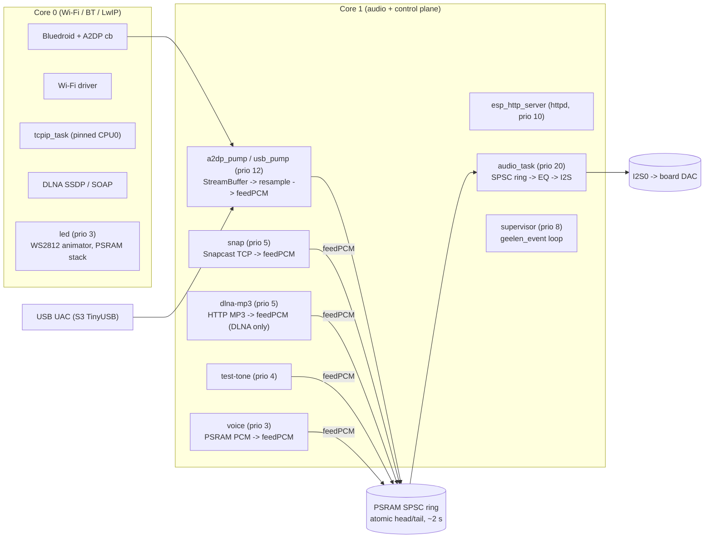
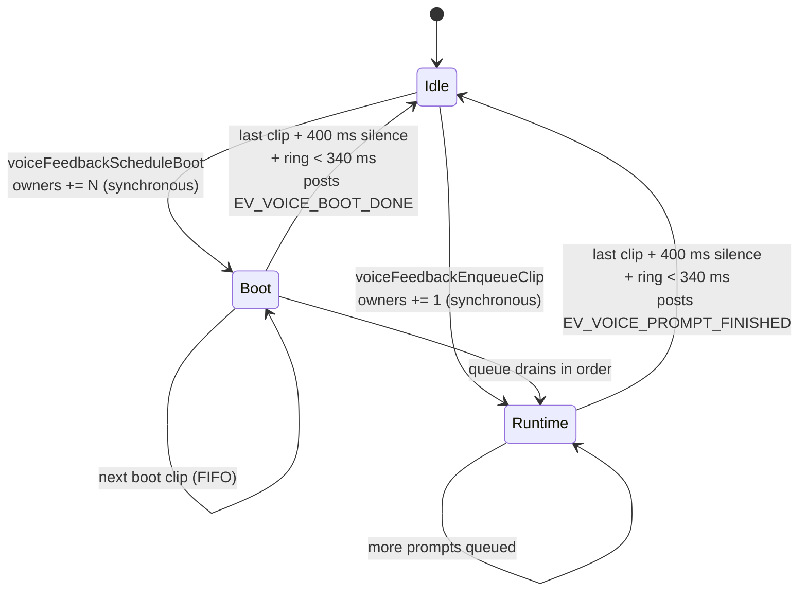

# Architecture

The firmware splits cleanly into two planes:

- the **audio path** — a tight producer → PSRAM ring → I2S loop pinned
  to Core 1, where every microsecond of jitter shows up as a glitch in
  the speaker, and
- the **control plane** — a dedicated `esp_event` bus (Core 1, prio 8),
  a supervisor task, the Mode Manager FSM, and the voice-prompt cache
  that decides *when* the audio path runs and *which* producer is
  authoritative.

This document covers the audio path. The control plane is its own
document — see [control_plane.md](control_plane.md) — because once you
understand the ring + I2S loop, every cross-cutting concern (Wi-Fi
reconnects, voice callouts, mode changes, push-based SPA state) lives
on the bus instead of being tangled into the producer code.

## Task graph



Source-of-truth references:

```51:59:ESP32_AudioPlatform/src/idf_main.cpp
static geelen::AudioEngine g_engine;
static i2s_chan_handle_t g_i2s_tx = nullptr;
static geelen_idf::ConfigManager g_cfg;
static geelen_idf::WifiManager g_wifi;
static geelen_idf::HttpServer g_http;
static geelen_idf::Snapclient g_snap;
#if CONFIG_BT_ENABLED
static geelen_idf::A2dpSink g_a2dp;
#endif
```

The audio task is pinned to Core 1 at priority 20 to outrank everything that
might preempt it. `a2dp_pump` / `usb_pump` sit at prio 12 — above httpd at 10 — so SPA
SSE accept/prune/JSON cannot stall PCM drainage; httpd must stay below the
pump. Other producers (Snapcast, MP3 streamer, voice) sit at prio 3–5 on
the same core so they can never starve I2S, while Wi-Fi / BT / LwIP keep
Core 0 free to do their own scheduling.

```265:278:ESP32_AudioPlatform/src/idf_main.cpp
static void audio_task(void*) {
  // … yield one tick only on prefill / rebuffer / empty-ring …
  for (;;) {
    if (!g_engine.process()) {
      vTaskDelay(1);
    }
  }
}
```

## Ring buffer + prefill / low-water

`AudioEngine` owns a PSRAM ring sized for ~2 s of stereo s16 at 44.1 kHz:

```39:46:ESP32_AudioPlatform/include/audio_engine.h
constexpr int SAMPLE_RATE = 44100;
constexpr size_t RING_BUF_SAMPLES = (size_t)SAMPLE_RATE * 2;
constexpr size_t RING_BUF_BYTES = RING_BUF_SAMPLES * sizeof(int16_t) * 2;

constexpr uint32_t AUDIO_PREFILL_MS = 500;
constexpr uint32_t AUDIO_LOW_WATER_MS = 300;
```

Two thresholds drive the producer/consumer dance:

- **Prefill (500 ms)** — the audio task waits for this much PCM before it
  starts hitting I2S. Going higher delays the first audible sample on cold
  boot; going lower starves I2S under jittery producers (BT/Snap).
- **Low-water (300 ms)** — if the ring drops below this while playing, the
  audio task flips into a "rebuffer" state and stays silent until prefill is
  hit again. Going below low-water mid-clip is exactly what produces the
  classic "first prompt is silent" symptom, so the voice task never lets the
  ring drain past `AUDIO_LOW_WATER_MS + 40 ms` between prompts. The last
  queued clip is padded with ~400 ms of silence first, so the ~300 ms the
  engine then abandons is zeros rather than the last syllable (see below).

`feedPCM` serializes multiple producers (A2DP, Snapcast, MP3, voice)
against each other with a small `producer_mutex_`. The consumer never
takes that lock: `ring_head_` / `ring_tail_` are atomics (SPSC between
the serialized producers and `audio_task`). EQ + limiter + volume run
inside `process()` on the consumer side, so producers never need to
know about DSP. A2DP resampling lives on `a2dp_pump` (Core 1 prio 12,
above httpd), not on the Bluedroid callback.

## MP3 streamer command queue

There is exactly one `geelen_idf::mp3::Streamer` in the process. It runs a
single decode task (`dlna-mp3`) on Core 1 and accepts commands via a
mutex-guarded single-slot mailbox:

```52:56:ESP32_AudioPlatform/src/idf_mp3_streamer.cpp
struct Command {
  enum class Kind { None, Play, Pause, Resume, Stop };
  Kind kind{Kind::None};
  char url[256]{};
};
```

Both DLNA SOAP `Play` and the voice serializer go through `playFile(...)` /
`play(http://…)`. Per-clip back-pressure inside `pumpOnce()` keeps the
decoder roughly real-time so it doesn't race ahead and overflow the engine
ring (which would silently drop the tail of every short SPIFFS clip):

```264:284:ESP32_AudioPlatform/src/idf_mp3_streamer.cpp
  bool pumpOnce() {
    // Back-pressure: Helix decode runs several × realtime, so for short SPIFFS
    // clips the producer would race ahead and `feedPCM` would silently drop
    // samples once the engine ring fills (audible as the tail of a clip
    // being cut off — e.g. "Bluetooth" without "mode"). Pace the decoder
    // to roughly realtime by waiting whenever the engine has a healthy
    // buffer ahead.
```

## Voice prompts (cached PCM)

Voice prompts used to live as MP3 files decoded on demand through the
shared MP3 streamer; that coupled the boot sequence to Helix init,
streamer command-mailbox availability, and a 3.5 s "boot settle"
ladder. Phase 2 replaced that with `idf_voice_cache.{h,cpp}`, which
decodes every prompt into raw PCM in PSRAM at boot and turns the voice
serializer into a tiny memcpy-paced feeder.



The producer-side gate (`voiceFeedbackActive()`) is a refcount bumped
SYNCHRONOUSLY on enqueue and dropped only AFTER the clip's PCM has been
fed AND the engine ring has drained back below the rebuffer threshold.
The last clip in the queue also feeds ~400 ms of silence before that
drain, so the engine's low-water rebuffer (which abandons the remaining
~300 ms) drops zeros rather than speech. Mid-sequence clips skip the
pad — the next clip tops the ring up and their tails play in full.
As long as the count is > 0, A2DP / Snapcast / DLNA producers refuse to
feed the ring.

The two prompt-finished events (`EV_VOICE_PROMPT_FINISHED`,
`EV_VOICE_BOOT_DONE`) are how DLNA's SOAP `Play` handler waits for the
boot pair to drain instead of polling a semaphore — see
[control_plane.md](control_plane.md).

Three properties this design gives us for free:

1. **No boot pre-roll gap.** `voiceFeedbackScheduleBoot` bumps owners
   BEFORE returning, so by the time `g_a2dp.begin()` / the snap task is
   created, A2DP/Snap PCM is already gated. The clip cache is already
   resident in PSRAM, so the first prompt plays immediately — no
   "settle" ladder.
2. **No stop/play race on `BluetoothConnected`.** The A2DP CONNECTED
   callback posts `EV_A2DP_CONNECTED`; the supervisor enqueues the
   clip. Because the queue is FIFO, the connected clip plays AFTER any
   in-flight boot mode clip — no abort, no command-mailbox stomp.
3. **Single source of truth.** Producers all gate on
   `voiceFeedbackActive()`, so adding a new producer (or a new prompt)
   does not require touching the gate-check pattern in three places.

## Producer gates

```127:135:ESP32_AudioPlatform/src/idf_a2dp_sink.cpp
void A2dpSink::a2dpDataCb_(const uint8_t* data, uint32_t len) {
  if (!engine_ || !data || len == 0) return;
  // Voice prompts share the engine ring via `feedPCM`. While any prompt is in
  // flight (including its tail-drain margin) the voice owner refcount is up;
  // SBC PCM mixed in here would splice over the clip and we'd lose tails like
  // "… Mode" or skip "Bluetooth connected" entirely. Single source of truth.
  if (geelen_idf::voiceFeedbackActive()) {
    return;
  }
```

```269:274:ESP32_AudioPlatform/src/idf_snapclient.cpp
    // Single source of truth for "voice prompt owns the ring": gate on it so
    // WireChunks don't splice into the middle of "Snapcast mode" / mode-clip.
    if (!geelen_idf::voiceFeedbackActive()) {
      engine_->feedPCM(buf_ + off, (size_t)n - off);
    }
```

DLNA's SOAP `Play` handler additionally waits for the boot pair to drain
before it hands the URI to the streamer — see [audio_modes.md](audio_modes.md).

## Where to go next

- [control_plane.md](control_plane.md) — event bus, supervisor + watchdog,
  Mode Manager FSM, voice cache lifecycle, Wi-Fi reconnect ladder, and
  the SSE state stream that replaces SPA polling.
- [audio_modes.md](audio_modes.md) — what each `AudioSource` does,
  why mode changes still reboot today (and which ones are about to
  hot-swap).
- [voice_prompts.md](voice_prompts.md) — every clip in the cache, when
  each fires, FIFO ordering guarantees.
- [eq.md](eq.md) — single-layer PEQ, software vs TAS5825M hardware backends.
- [board_variants.md](board_variants.md) — four PlatformIO envs and HAL pins.
- [wifi_onboarding.md](wifi_onboarding.md) — validate-then-commit, AP
  fallback, reconnect ladder, captive HTML, `/wifi` SPA page.
