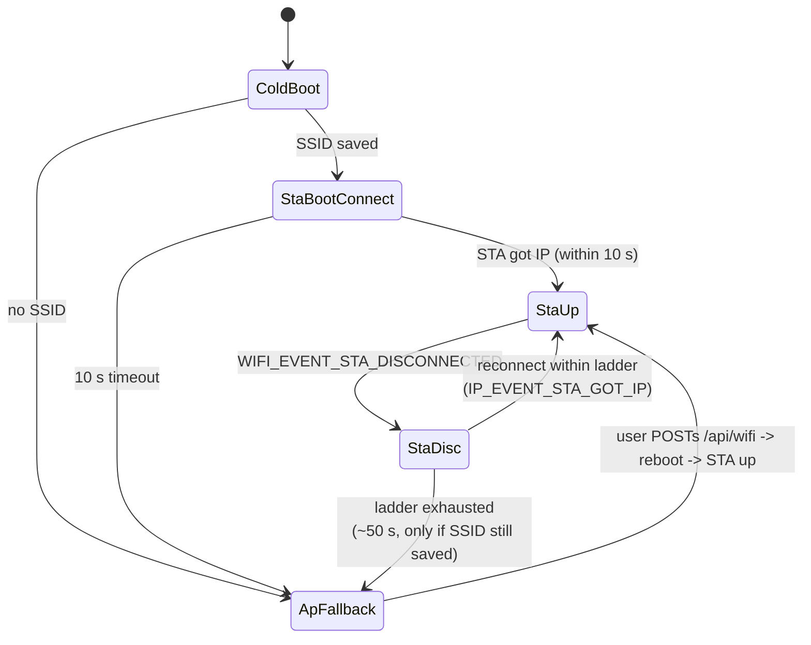
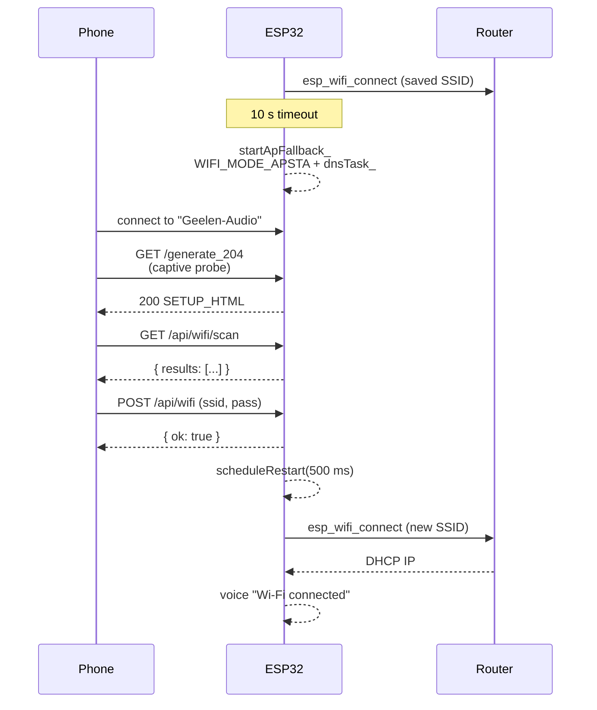

# Wi-Fi onboarding

The device wants to be on the user's home Wi-Fi (STA mode). If that is
not possible — no credentials saved, wrong password, network unavailable
— it brings up a small captive portal so the user can fix it from a
phone, then reboots into STA. Bluetooth keeps working in either case.

## States



## Cold boot

```77:95:ESP32_AudioPlatform/src/idf_wifi_manager.cpp
  char ssid[WIFI_SSID_MAX] = {0};
  char pass[WIFI_PASS_MAX] = {0};
  cfg_->getWifiSsid(ssid, sizeof(ssid));
  cfg_->getWifiPass(pass, sizeof(pass));

  if (ssid[0] != '\0') {
    startSta_(ssid, pass);
    if (waitForStaIp_(10000)) {
      status_.sta_connected = true;
      status_.ap_running = false;
      ESP_LOGI(TAG, "STA up, AP not started");
      return true;
    }
    ESP_LOGW(TAG, "STA failed, falling back to AP");
  }

  startApFallback_();
  return true;
}
```

If credentials are saved, we try STA for 10 s. If we get an IP, we are
done. If not (or no SSID was saved), we drop straight into the AP
fallback.

## AP fallback (captive portal)

```122:143:ESP32_AudioPlatform/src/idf_wifi_manager.cpp
void WifiManager::enableSoftApPhy_() {
  wifi_config_t ap_config{};
  std::strncpy((char*)ap_config.ap.ssid, AP_SSID, sizeof(ap_config.ap.ssid) - 1);
  std::strncpy((char*)ap_config.ap.password, AP_PASS, sizeof(ap_config.ap.password) - 1);
  ap_config.ap.ssid_len = std::strlen(AP_SSID);
  ap_config.ap.channel = 1;
  ap_config.ap.max_connection = 4;
  ap_config.ap.authmode = WIFI_AUTH_WPA_WPA2_PSK;
  if (std::strlen(AP_PASS) == 0) ap_config.ap.authmode = WIFI_AUTH_OPEN;

  // APSTA (not pure AP) so `esp_wifi_scan_start` works while we are showing
  // the onboarding portal — `esp_wifi_scan_*` requires STA or APSTA mode.
  ESP_ERROR_CHECK(esp_wifi_set_mode(WIFI_MODE_APSTA));
  ESP_ERROR_CHECK(esp_wifi_set_config(WIFI_IF_AP, &ap_config));
  ...
}
```

- SSID: `Geelen-Audio`, password: `geelen123` (WPA2). Open if the
  password were ever blanked.
- Mode: `WIFI_MODE_APSTA` (not pure AP) so the `/api/wifi/scan` endpoint
  can drive `esp_wifi_scan_*` while showing the captive page.
- A tiny DNS responder (`dnsTask_`) replies to every A query with
  `192.168.4.1`. Combined with the captive HTTP probe handlers, every
  popular OS detects "you're on a captive network" and pops a browser at
  the right place.

### Captive HTTP probes

The HTTP server intercepts known captive-detection URLs and serves a
self-contained HTML page that lets the user pick an SSID and submit
credentials. From `idf_http_server.cpp`:

- `connectivitycheck.gstatic.com/generate_204` (Android)
- `captive.apple.com` / `www.apple.com/library/test/success.html` (iOS, macOS)
- `www.msftconnecttest.com/connecttest.txt` (Windows)
- `connectivity-check.ubuntu.com` (Ubuntu / GNOME)
- `nmcheck.gnome.org/check_network_status.txt` (NetworkManager)
- `/.well-known/captive-portal` (RFC 8908)

In STA mode the same probes return canonical "success" responses so the
user's OS reports "Wi-Fi connected" without weird captive UI.

## Setup HTML

The captive page is a small inline form (`SETUP_HTML` in
`idf_http_server.cpp`) that talks to two endpoints:

- `GET  /api/wifi/scan` — runs `esp_wifi_scan_start`, returns a JSON list
  of nearby SSIDs with RSSI + open/closed.
- `POST /api/wifi` — `application/x-www-form-urlencoded` body with
  `ssid=...&pass=...`. Persists to NVS, schedules a reboot, returns
  `{"ok": true}`.

Once flashed, the user sees the boot voice clip switch from
"Wi-Fi not connected" to "Wi-Fi connected" on the next boot.

## SPA `/wifi` page

When the device is on STA, the same form is reachable from the main SPA
under `/wifi`. The Overview dashboard surfaces a "Setup hotspot active"
banner with a link to `/wifi` whenever `wifiState.ap_only` is true.

The SPA page calls `getWifiScan()` and `getWifiState()` via `web/api.js`,
shows a populated dropdown, and hits the same `POST /api/wifi`.

## Runtime recovery (exponential backoff ladder)

The pre-rewrite implementation waited a flat 8 s after a disconnect and
then flipped straight to AP fallback — i.e. zero reconnect attempts.
The most common Wi-Fi blip on this device is a 2–5 s router DHCP renew
or a Bluetooth coexistence stall, so users routinely saw the captive AP
for transient issues that would have cleared on their own.

Phase 1 (see [control_plane.md](control_plane.md)) replaces that with
an exponential backoff ladder:

```c
// src/idf_wifi_manager.cpp
static constexpr int64_t kReconnectDelayUs[] = {
    500'000,        //  500 ms — first attempt absorbs router blips
    1'000'000,      //  1 s
    2'000'000,      //  2 s
    5'000'000,      //  5 s
    10'000'000,     // 10 s
    30'000'000,     // 30 s — cap reused for every subsequent attempt
};
static constexpr uint8_t kMaxReconnectAttempts = 6;
```

On `WIFI_EVENT_STA_DISCONNECTED` we clear `status_.sta_connected`,
post `EV_WIFI_DOWN` to the Geelen bus, and arm the next ladder step.
Each timer fire calls `esp_wifi_connect()`. `IP_EVENT_STA_GOT_IP`
cancels the timer, resets the counter, and posts `EV_WIFI_UP`.

Only after ~50 s of cumulative backoff (six failed attempts) does
`startApFallback_()` run, posting `EV_WIFI_AP_FALLBACK` so the
supervisor and any future module (DLNA SSDP gating, Mode Manager) can
react without polling `WifiManager::status()`.

`startApFallback_` is idempotent: a second call while the AP is already
running short-circuits.

## Sequence



## Bluetooth coexistence during AP-only

```196:217:ESP32_AudioPlatform/src/idf_main.cpp
static constexpr int kBtDeferPollMs = 500;
// 120 * 500 ms = 60 s max wait while still in captive AP-only mode.
static constexpr int kBtDeferMaxPolls = 120;

static void deferred_a2dp_start_task(void*) {
  for (int i = 0; i < kBtDeferMaxPolls && g_wifi.isApOnly(); ++i) {
    vTaskDelay(pdMS_TO_TICKS(kBtDeferPollMs));
  }
  if (!g_wifi.isApOnly()) {
    ESP_LOGI("geelen", "Wi-Fi left AP-only mode; starting Bluetooth A2DP");
  } else {
    ESP_LOGW(
        "geelen",
        "Wi-Fi still in captive AP after %u s — starting Bluetooth anyway "
        "(pair for audio without fixing Wi-Fi)",
        (unsigned)((kBtDeferMaxPolls * kBtDeferPollMs) / 1000));
  }
  g_a2dp.begin("Geelen Audio");
  vTaskDelete(nullptr);
}
```

APSTA + Bluedroid both want substantial RAM at boot. Starting Bluedroid
while APSTA is up has been observed to exhaust the BT OSI timer pool
(`osi_alarm_new err 0x101`) on cold boot. The deferred task waits up to
60 s for STA to come up (or for the user to disable AP onboarding) and
THEN starts A2DP — but it always eventually starts A2DP, so a user with
no Wi-Fi can still pair their phone after the deferral expires.
