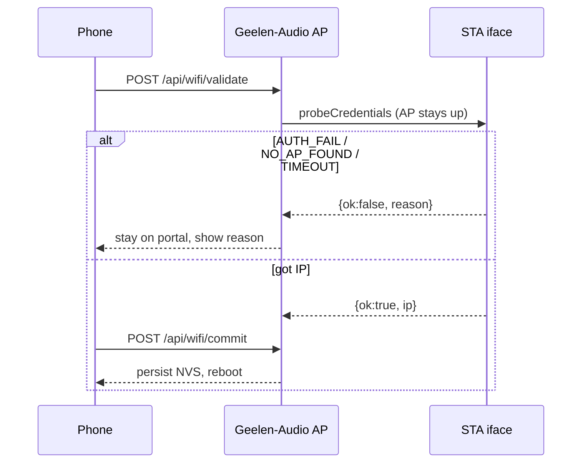
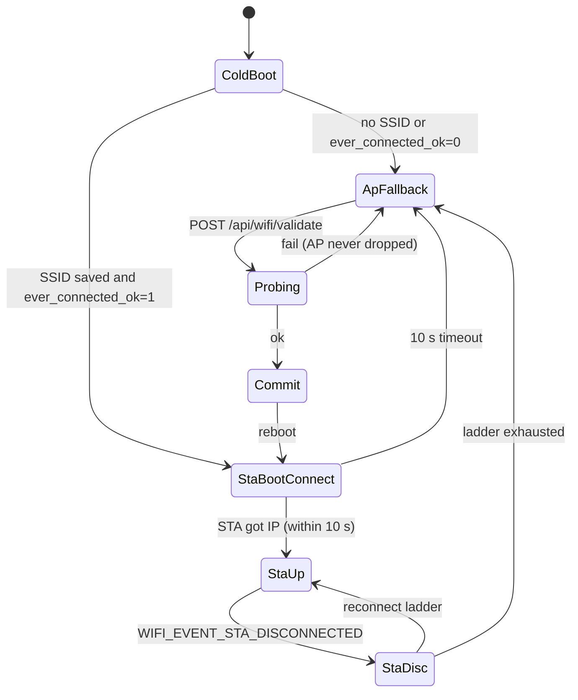

# Wi-Fi onboarding

The device wants to be on the user's home Wi-Fi (STA mode). Credentials are
**validated before they are saved**. Wrong passwords never reboot and never
tear down the captive AP.

## States

## Root cause of the old cycling

`POST /api/wifi` used to persist then `scheduleRestart(800 ms)`. On boot the
device tried STA for 10 s with **no AP**. Failure flipped to APSTA, which
made Geelen-Audio disappear/reappear so the phone jumped to home Wi-Fi
instead. The reconnect ladder could still poke STA while APSTA was up.

## Validate then commit

- `POST /api/wifi/validate` `{ssid, pass}` does **not** persist. It calls
  `WifiManager::probeCredentials` (timeout 12 s) while the AP stays up.
- `POST /api/wifi/commit` persists the last successful probe, sets
  `wifi_ever_connected_ok`, and reboots. 400 if nothing was validated.
- Legacy `POST /api/wifi` (form-encoded) now probes first and only
  persists+reboots on success, returning `{ok:false, reason, detail}` on
  failure so the captive page can show `AUTH_FAIL`.

Reason codes: `AUTH_FAIL`, `NO_AP_FOUND`, `ASSOC_FAIL`, `TIMEOUT`, `FAIL`.

## Cold boot

If an SSID is saved **and** `wifi_ever_connected_ok` is explicitly 0, STA
is skipped and the device goes straight to AP. A missing flag (upgrade
from older firmware) still tries STA once; GOT_IP then sets the flag.

The exponential reconnect ladder still runs in STA-only mode. It does
**not** run while `ap_running` or while a probe is in progress.

`/api/state.wifi.state` is `idle` | `probing` | `ok` | `failed`.

## STA-mode validate

Calling `POST /api/wifi/validate` from a browser that is already on the
device's STA address will drop that TCP connection: the STA interface
must leave the current AP to try the candidate credentials. Onboarding
through the captive AP is unaffected (the phone stays on Geelen-Audio).
After a failed probe the previous STA config is restored automatically.
